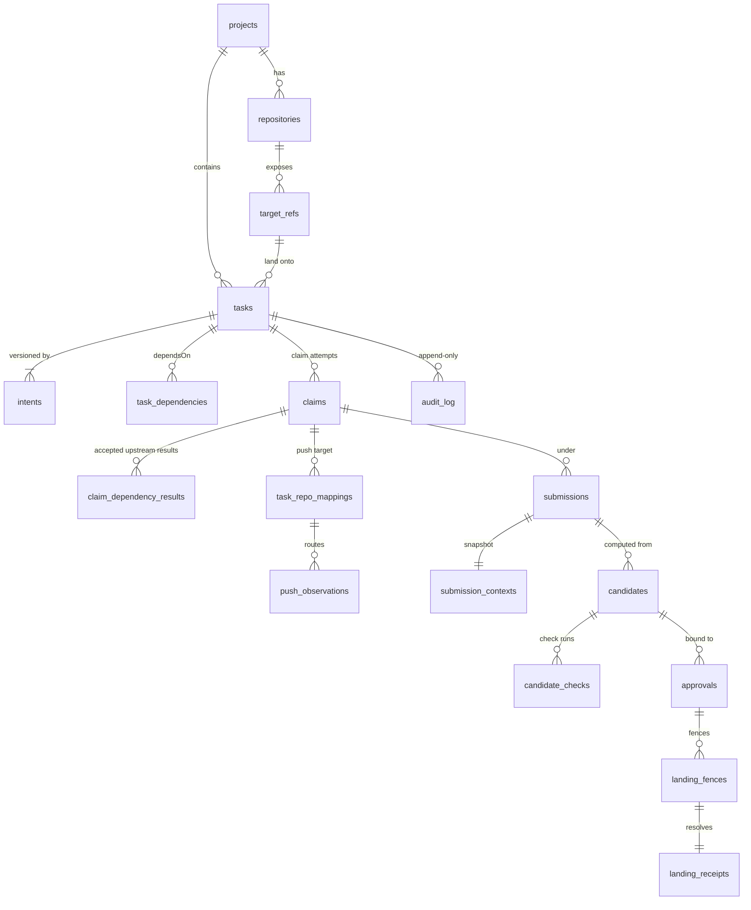
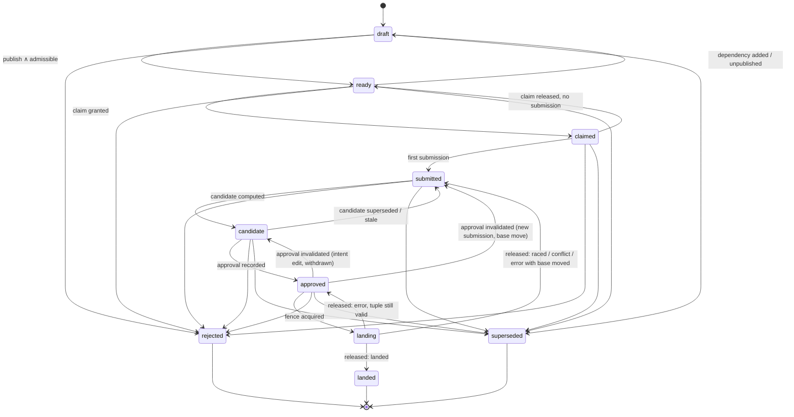

# The collaboration record

**Status:** Implemented and tested on Miniflare and local D1. The integrator runner and Cloudflare Containers are provisional. This document defines the record that the control plane implements and must not be weakened; §15 lists the authoritative handlers.

**Design goals.** This is a hosting-native, agent-independent collaboration record: versioned intent and accepted dependency results carried through immutable submission → tested integration candidate → exact approval → reconciled landing receipt, stored by the host and queryable by humans and any agent client. The record keeps **intent edit history**, a **stored human approval**, an **append-only audit log**, and a landing receipt that is **not mutated after creation**. Approval validity binds to an immutable submission record + `(candidate SHA, base SHA)` + intent version, never to a `(repo, ref, after)` tuple, and `before != recorded head` is a reconciliation trigger, not a verdict. The landing race boundary is the **landing fence** (§8).

**Storage and topology.** D1 holds the record, with D1 batches as the transaction unit; one SQLite-backed `TaskCoordinator` Durable Object per task coordinates it (per-target landing serialization is the D1 `canonical_one_held_fence` index, §8.2); Artifacts (or a registered BYO provider) holds git. The landing protocol (fence → dispatch → staged changes → reconcile by fetched-object ancestry → receipt → release → apply staged) is specified in §8; this document is authoritative for the record's shape and invariants, and [How the client talks to the service](README.md#how-the-client-talks-to-the-service) describes placement. Artifacts canonicals use chain-mode repo lanes ([ADR 0003](adr/0003-chain-mode-repo-lanes.md)) and BYO canonical providers use ref lanes ([ADR 0010](adr/0010-byo-canonical-provider.md)); `task_repo_mappings.kind` carries either.

**Schema.** The record lives in Cloudflare D1 (SQLite). Table and column names below are the schema's own; triggers, `CHECK` constraints and partial unique indexes enforce the rules this document states, and offline binding export and recovery operations add no route, event type or record-state change.

---

## 1. Vocabulary and ground rules

| Term | Meaning |
| --- | --- |
| **Human** | A principal authenticated through the configured OIDC provider and holding an Octocove session. Only humans publish, reject and authorize claims. Humans approve through the legacy session route; a registered approval principal (`human`, `policy_bot` or `workload`) may also approve through a verified grant under [ADR 0001](adr/0001-machine-approval-authority.md), see §7.2 and [Approval, exact-candidate](GLOSSARY.md#approval-exact-candidate-approvals-approval). |
| **Agent** | A principal holding an Octocove-issued delegation (bound to a human authorizer, project, task and claim attempt). Agents claim and submit. |
| **Integrator** | The trusted native-git runner; the only holder of canonical write credentials. Computes candidates and lands them. Reports; never decides policy. |
| **System** | The control plane acting on its own rules (admission re-evaluation, invalidation, release). |
| **Canonical** | The repository + target ref a task lands onto (`tasks.repository_id`, `tasks.target_ref`), e.g. `refs/heads/main` of the project repo. |
| **Attempt** | One agent's run at a task under one granted claim: its submissions, candidates and approvals. A task may have several attempts over time, at most one live. |
| **Live** | An attempt-level record whose active status still carries authority: claim `active`, candidate `active`/`fenced`, approval `active`/`fenced`, fence `held`. |

Ground rules that apply to every record below:

1. **Immutable records never change.** Intent versions, submissions, submission contexts, candidate check runs, landing receipts and audit rows have no mutable columns at all. Claims, candidates, approvals and fences have immutable *fields* plus a small set of *status* columns; D1 triggers reject any `UPDATE` touching an immutable column and any `DELETE`. "Invalidating an approval" means changing `approvals.status`, never editing `boundTo`.
2. **Status changes are enumerated.** Each status-bearing table has a `*_status_transitions` table seeded in the migration; a trigger refuses any transition not listed. The tables in this document are the same lists.
3. **Task status ≠ attempt status.** `tasks.status` describes the lifecycle of the task's *accepted result*. Claims, candidates and approvals carry their own status. A candidate can be superseded while the task stays `submitted`; a claim can be superseded while the task stays `claimed`; a landed task can carry a live follow-up candidate (§8.5).
4. **Every transition writes exactly one audit row in the same D1 batch** (`db.batch([...])` is transactional on D1). Neither the transition nor the audit row exists without the other. **One enforced exception:** the database trigger `submission_pairs_observation` pairs an unsubmitted push observation with a newly inserted submission by updating `push_observations` (`flag='matched'`) and inserting its own `observation.flagged` audit row inside the submission-insert batch. That second transition is produced by the database, not by the transition writer (§16.1), so a submit that pairs an observation writes two audit rows (`submission.created` plus `observation.flagged`) in one batch; the row is still atomic with the state change it describes.
5. **Ids are explicit.** Every record has its own id (`candidates.id`, `approvals.id`, `landing_fences.id`, …). Clients refer to records by id, never by SHA alone; SHAs are evidence, ids are identity.
6. **Time and ids.** Timestamps are ISO-8601 UTC text. Ids are opaque identifiers (ULIDs, UUIDs and prefixed hashes all occur); clients must not parse them or sort by them. Ordering questions inside a task are answered by `submissions.seq` and `intents.version`, never by wall-clock or event arrival.

### 1.1 Record map



---

## 2. Identity: project, canonical repository, target ref

| Table | Fields | Notes |
| --- | --- | --- |
| `projects` | `id`, `slug` (unique), `name`, `created_by`, `created_at` | The deployment's D1 database is the tenant boundary. `projects` groups tasks inside that database; each project is shown as the `[org]` segment in the review UI. Membership and authorization are owned by the auth module, keyed on (issuer, `sub`). |
| `repositories` | `id`, `project_id`, `provider` (`artifacts`), `provider_namespace`, `provider_repo_id`, `name`, `role` (`canonical` \| `task` \| `staging`), `created_at`, `deleted_at` | One row per Artifacts repository Octocove knows about: the canonical repo and, for `task-repo` lanes, each task repo. `(provider, namespace, provider_repo_id)` is unique. Rows are soft-deleted (`deleted_at`) so receipts keep resolving. |
| `target_refs` | `(repository_id, ref_name)` PK, `known_head_sha`, `known_head_at`, `known_head_source` (`seed` \| `receipt` \| `ls-remote` \| `event`) | The ref a task lands onto. `known_head_*` is the last canonical head the control plane has evidence for. It is a **cache of observed truth, never authority**: the integrator's compare-and-swap push is the authority; this column exists so that base moves can be detected and so that approvals can be invalidated pre-fence (§7.3). |
| `task_repo_mappings` | `id`, `task_id`, `claim_id`, `kind` (`task-repo` \| `lane-ref`), `repository_id`, `ref_name`, `created_at`, `retired_at` | Where an agent pushes for a task, durably. For `task-repo` it is the task repo's default branch (a per-task fork or a chain lane, [ADR 0003](adr/0003-chain-mode-repo-lanes.md)); for `lane-ref` a lane ref in canonical ([ADR 0010](adr/0010-byo-canonical-provider.md), [ADR 0002](adr/0002-own-clone-source-registration.md)). Events are routed to tasks **only** through this table, never through an active token grant. At most one live mapping per `(repository, ref)`; retired, never deleted. [ADR 0002](adr/0002-own-clone-source-registration.md) permits an existing canonical ref with an external writer; `external_ref_sources` retains immutable initial expected-SHA evidence without adding a lane entity or claimant Git grant. |

---

## 3. Intent

Intent is the contract an agent works against: *the agent's context is the contract, not a chat history*. It is versioned; every edit is a new row; the table is the history.

| Column | Definition |
| --- | --- |
| `task_id`, `version` | PK. `version` starts at 1 on task creation and increments by exactly 1 on every edit. |
| `title` | Non-empty. |
| `description` | Free text (may be empty). |
| `acceptance_criteria` | JSON array of strings. First-class because every client (CLI agent, CI approver, adapter) checks work against the same criteria. |
| `change_note` | Why this version exists (optional). |
| `author_type`, `author_id` | Who edited (`human`, `agent` when an agent proposes a clarification that a human accepts through the API, or `system`). |
| `staged_behind_fence_id` | Set when a held fence existed on the task at edit time (§8.3). The row is recorded immediately; its lifecycle effect is deferred. |
| `created_at` | |

`tasks.current_intent_version` is the version clients see and the version approvals bind to. `intentVersion` in the API is this number.

- **Effect of an edit** (§7.3): an unfenced active approval on the task is invalidated with reason `intent-edit`; the live candidate stays live (its objects did not change; the human must re-approve against the new version). While a fence is held the edit is staged and has no effect on the fenced approval. Edits on a task in a terminal status are refused (`409 task-closed`); supersede the task instead.

---

## 4. Task

| Column | Definition |
| --- | --- |
| `id`, `project_id`, `repository_id`, `target_ref`, `key` | Identity: never changes after creation. `key` is the human-facing handle, unique per project. |
| `status` | Task status; see state machine below. |
| `status_changed_at` | |
| `current_intent_version` | §3. |
| `published_at` | A human declared the intent complete. Admission (draft → ready) is evaluated only once set. |
| `accepted_receipt_id` | Write-once. The landing receipt that made the task `landed`; the **accepted result** dependents are admitted on. |
| `superseded_by_task_id`, `closed_at` | Set iff terminal. |
| `created_by`, `created_at`, `updated_at` | |

`task_dependencies (task_id, depends_on_task_id)` is the `dependsOn` set; rows are immutable and removable only while the dependent is `draft` or `ready` (trigger).

### 4.1 State machine (task status)



The forward path is: `draft → ready → claimed → submitted → candidate → approved → landing → landed | rejected | superseded`. The backward arrows are the stale-base/recompute/re-approval loop; each is listed in `task_status_transitions` with its trigger. `landing` cannot be rejected or superseded: the fence is a committed authorization and must resolve first (§8).

| From → to | Trigger | Actor |
| --- | --- | --- |
| draft → ready | `publish` and `v_task_admission.admissible = 1`; also re-evaluated by the system whenever an upstream lands | human / system |
| ready → draft | dependency added, or unpublished | human |
| ready → claimed | claim granted (§5) | agent (with human authorizer) or human |
| claimed → ready | active claim released/revoked/expired and no submission exists | agent / human / system |
| claimed → submitted | first submission on the task | agent / human |
| submitted → candidate | integrator reports a `computed` candidate for the **latest** submission | integrator |
| candidate → submitted | live candidate superseded (new submission), stale (base move), or withdrawn without an active approval | system |
| candidate → approved | approval recorded (§7) | human (legacy session), or registered grant principal under ADR 0001 (§7.2) |
| approved → candidate | approval invalidated by `intent-edit` or `withdrawn` (candidate stays live) | system |
| approved → submitted | approval invalidated by `submission` or `base-move` (candidate superseded/stale) | system |
| approved → landing | fence acquired (§8.1) | human (or agent, if project policy allows `land`) |
| landing → landed | fence released with resolution `landed` | system, on integrator report + reconciliation |
| landing → submitted | fence released with `raced`/`conflict`, or `error` with canonical head ≠ base | system |
| landing → approved | fence released with `error` and canonical head still = base | system |
| any non-landing, non-terminal → rejected / superseded | human closes the task | human |

### 4.2 Admission rule

A dependent is admissible only when **every** upstream in `dependsOn` is `landed` **with an accepted result** (`accepted_receipt_id` set, which always names a receipt with outcome `landed` for the same task). A rejected, superseded, or merely approved upstream does not count. The view `v_task_admission` computes this; `v_task_dependency_state` lists each edge with the upstream's receipt id and landed SHA, which is what gets copied onto the claim (§5). A task cannot depend on itself and the dependency graph stays acyclic: an edge that would close a cycle is refused `409 dependency-cycle`. Dependency edges can be added or removed only while the dependent task is `draft` or `ready`.

---

## 5. Claim attempt

Every attempt to claim is persisted, granted or refused. The granted claim is the attempt's root: submissions reference it, the token broker's grant follows it (not the task status), and its `claim_dependency_results` are the exact upstream results the admission check saw.

| Column | Definition |
| --- | --- |
| `id`, `task_id` | |
| `actor_type`, `actor_id` | `agent` or `human`. |
| `authorized_by` | The human whose session pre-authorized an agent claim. Required for agents (CHECK). |
| `delegation_id` | The Octocove delegation issued for this attempt. Opaque here; required when an agent claim is granted (CHECK). |
| `intent_version` | The intent version shown to the claimant (FK to `intents`). |
| `requested_at` | |
| `result` | `granted` \| `refused-not-ready` \| `refused-already-claimed` \| `refused-dependency-unlanded` \| `refused-unauthorized` \| `refused-task-closed`. Immutable. |
| `refusal_detail` | Human-readable (e.g. which upstream is unlanded). |
| `idempotency_key`, `expires_at` | |
| `status` (attempt status, mutable) | `active` → `released` (agent gave up or expired) \| `revoked` (human) \| `superseded` (a newer claim was granted for the task) \| `completed` (landed). Present iff `result = 'granted'` (CHECK). |
| `status_changed_at`, `status_reason` | |

`claim_dependency_results (claim_id, upstream_task_id, receipt_id, landed_sha)`: one immutable row per `dependsOn` edge, copied from `v_task_dependency_state` inside the claim transaction.

**Who may claim.** Status `ready` with no active claim; or status `claimed`/`submitted`/`candidate`/`approved` with no active claim (take-over after a release), in which case the new claim's `status_reason` is `takeover` and existing submissions remain part of the record. A claim on `draft` is `refused-not-ready`; on `landing` or a terminal status `refused-task-closed`. A second concurrent claimant gets `refused-already-claimed` (the task's `TaskCoordinator` Durable Object serializes claims; the partial unique index is the backstop, and a zero-row conditional update is treated as a refusal, never as success).

---

## 6. Submission and its context snapshot

For external-writer ref lanes, submission admission first fetches and verifies the registered canonical commit object using a broker read grant. It pins the submitted SHA; compute rechecks for `stale-head`. Remote identity and owning attempt are mandatory verification boundaries. Client Git credentials are never used by the integrator.

A submission is the agent saying "this commit, on this base, against this intent version, is my work." **A new push is a new submission, never an update.** Observations from the provider (`push_observations`) are evidence that something moved; only an authenticated `submit` binds an actor.

### 6.1 `submissions` (immutable)

| Column | Definition |
| --- | --- |
| `id`, `task_id`, `claim_id` | The claim must be `active` on this task at creation. |
| `seq` | Per-task sequence, 1, 2, 3… gapless. The ordering authority for "newer submission". |
| `actor_type`, `actor_id` | Who submitted. |
| `submitting_principal_id`, `on_behalf_of_principal_id` | Immutable canonical provenance for new submissions; historical missing provenance denies grant-derived self-approval checks. |
| `source_sha` | The commit the agent submits (the head it pushed). |
| `base_sha` | The canonical head the agent built on, **as stated by the agent at submission**. |
| `intent_version` | Equals `tasks.current_intent_version` at creation (FK to `intents`). |
| `mapping_id` | Where the push went (§2). |
| `message` | Optional note. |
| `staged_behind_fence_id` | Set iff a fence was held on the task at creation (§8.3). |
| `idempotency_key`, `created_at` | |

### 6.2 `submission_contexts` (immutable, one per submission, same batch)

The frozen copy of what the submitter was working against: `intent_version`, `intent_title`, `acceptance_criteria` (copied text, not a reference), `base_sha`, `canonical_head_sha` (the control plane's `known_head_sha` at that instant, so a base mismatch is visible at once), `actor_type`/`actor_id`, `claim_id`, `dependency_results` (JSON array of `{upstreamTaskId, receiptId, landedSha}` equal to the claim's `claim_dependency_results`), `snapshot_at`. A reviewer reads this to know what the agent was told, even if the intent has moved on since.

### 6.3 `push_observations`

One row per provider event (`pushed`, `forked`, `deleted`) or control plane `ls-remote`, deduplicated on `event_id` (the event's transport identity, or a documented transport-derived identity). Routed to a task via a live mapping. Classification (`flag`) is the only mutable part: `matched` to a submission, `unsubmitted-push` (lane moved, nobody submitted), `unknown-repo`, `reconcile` (`before != known head`, triggers an ls-remote), `canonical` (an observation on a target ref, which updates `target_refs.known_head_*`).

---

## 7. Candidate, checks, approval

### 7.1 `candidates`

One row per integrator **compute run**. `outcome = 'computed'` is a candidate proper: the integrator built the squash commit `candidate_sha` on `base_sha`, persisted its objects at `candidate_ref` (`refs/candidates/<id>` in canonical, or the staging repo if the topology decision says so) **before** any review, and recorded the check identity. The other outcomes keep the evidence of a blocked compute: `conflict` (with `conflict_files`), `stale-base` (canonical moved before compute), `stale-head` (the submission's `source_sha` was not what the lane held), `error`.

| Column | Definition |
| --- | --- |
| `id`, `task_id`, `submission_id` | |
| `outcome` | As above. Immutable. |
| `candidate_sha`, `base_sha`, `candidate_ref` | `candidate_sha`/`candidate_ref` set iff `computed` (CHECK). `base_sha` is the canonical head the candidate was built on. |
| `check_identity` | `sha256(check_policy ‖ candidate_sha ‖ base_sha)`: identifies *what* was checked. |
| `check_policy` | JSON object: the configured checks (commands, images, timeouts) or `{"kind":"none"}`. |
| `conflict_files`, `error_detail` | Evidence for blocked outcomes. |
| `compute_run_id` | Integrator run id, unique. |
| `recomputed_from_candidate_id`, `recompute_reason` | Set together when this run replaces an earlier candidate: `base-move`, `raced`, `fence-released`, `staged-after-landing`, `manual`. |
| `computed_at`, `created_at` | |
| `status` (attempt status, mutable) | `active` → `fenced` → `landed` \| `raced` \| `failed`; `active` → `superseded` (newer submission) \| `stale` (base moved) \| `withdrawn` (agent) \| `rejected` (human); `fenced` → `stale` (release after error with base moved) \| `active` (release after error, base unchanged). Blocked outcomes are born `failed` (CHECK). |
| `status_changed_at`, `status_reason`, `status_ref` | `status_ref` carries the id that caused the change (the newer submission, the receipt that moved the base, …). |

`candidate_checks` is append-only: `id`, `candidate_id`, `check_identity`, `run_id` (unique), `result` (`passed` \| `failed` \| `error` \| `skipped`), `evidence` (JSON: log locations, exit codes, summaries), `started_at`, `finished_at`, `recorded_at`. A rerun is a new row. "The candidate's check result" means the most recently recorded run for that candidate.

### 7.2 `approvals`

An authorized principal's statement that **this exact candidate, on this exact base, satisfies this exact intent version**. Legacy human sessions retain their existing behavior. Grant-derived approvals follow accepted [ADR 0001](adr/0001-machine-approval-authority.md), with immutable approver kind/identity, grant ID, versioned policy ID, evidence references, check-run IDs and authority expiry. The three bound values are copied into the approval row; they are not looked up through the candidate at validation time.

| Column | Definition |
| --- | --- |
| `id`, `task_id`, `candidate_id` | |
| `approved_by`, `approved_at` | Human session identity, or canonical registered grant principal. |
| `approver_kind`, `approval_grant_id`, `policy_version`, `evidence_refs`, `check_run_ids`, `authority_expires_at` | Immutable grant authority snapshot; legacy kind defaults to `human`, other legacy evidence is absent. |
| `bound_candidate_sha`, `bound_base_sha`, `bound_intent_version` | The `boundTo` triple. Immutable. `bound_intent_version` is an FK to `intents`. |
| `note`, `idempotency_key` | |
| `status` (active status, mutable) | `active` → `fenced` → `consumed`; `active` → `invalidated`; `fenced` → `invalidated` (landing raced/conflict); `fenced` → `active` (fence released after an infrastructure error with the tuple intact). `consumed` and `invalidated` are terminal. |
| `status_changed_at` | |
| `invalidation_reason`, `invalidation_ref` | Set iff `invalidated` (CHECK): `submission` (ref = submission id), `base-move` (ref = receipt or observation id), `intent-edit` (ref = version), `withdrawn`, `task-closed`, `landing-raced` / `landing-conflict` (ref = receipt id). |

**Recording an approval** (`POST /candidates/:id/approve`) succeeds only if, atomically: the candidate is the task's live `active` candidate with `outcome = 'computed'`; the request's `boundTo` equals exactly `(candidate.candidate_sha, candidate.base_sha, tasks.current_intent_version)`; the candidate's latest check run is `passed` (or `check_policy.kind = 'none'`); the task is in `candidate` (or `landed`, for a follow-up attempt, §8.5); no fence is held; the caller is a human with approve rights. Any mismatch is `409 approval-mismatch` with the current triple in the body so the UI can re-render. Multi-approver policies are out of scope for this record; one live approval per candidate.

**Recording a grant-derived approval** (`POST /candidates/:id/approve-with-grant`) is the
registered-principal path under accepted [ADR 0001](adr/0001-machine-approval-authority.md); the legacy route above stays human-only.
The public route verifies the opaque approval credential and forwards the request to the
task's coordinator, which verifies it again; trusted `TaskLifecycle.approveWithGrant`
rechecks authority, applies the same exact-tuple and eligibility checks, and consumes the
grant in the approval batch (`201` with grant-derived approver kind, identity and grant ID).
Machine approval requires both the principal's policy permission **and** the
project/target opt-in; with no opt-in the target stays human-only, which is the default.
Ordinary agent delegation still cannot approve, and an approval grant cannot claim,
submit, withdraw or land: landing authority stays separate. Checked-in implementation is
not live archetype qualification. See [Approval, exact-candidate](GLOSSARY.md#approval-exact-candidate-approvals-approval). `auth_assertion_uses` and `approval_grant_decisions` retain replay,
encrypted exchange recovery and sanitized decision evidence. The existing check policy records one aggregate run for all required commands;
its latest row is the pinned required run, or the empty set for an explicit no-check
policy. Null-principal `approval_policies` rows are the explicit target opt-in;
principal-specific rows carry the independent permission. Key/issuer bindings may rotate by appending policy `trust_bindings`; principal
identity remains immutable. AUTH verifies those bindings and revokes/replaces their
policy version when trust is disabled. Version replacement selects the highest version, including revoked versions (never fallback).
Issuance/use/revocation and principal/policy registration/revocation audit types
are database-owned triggers; AUTH must not append a duplicate logical transition.
Grant decision/refusal and approval/task transitions use `appendTransitions`.
Grant token hashes are stored; raw proofs and credentials never enter audit. New submissions pin canonical
submitter and delegated on-behalf-of provenance; old submissions are not reattributed.

### 7.3 Exactly which transitions clear an unfenced approval

An approval in status `active` (recorded, not yet fenced) becomes `invalidated` the moment any element of its bound triple is no longer the task's current truth. The complete list, one row per change, with what happens to the candidate and the task:

| # | Change on the task | Why the triple broke | Approval → | Candidate → | Task → | Reason / ref |
| --- | --- | --- | --- | --- | --- | --- |
| 1 | A new submission is created (`seq` greater than the approved candidate's submission) | the candidate no longer represents the agent's work | `invalidated` | `superseded` | `submitted` | `submission` / submission id |
| 2 | The canonical target ref's known head changes to something ≠ `bound_base_sha` — detected by a `landed` receipt on the same `(repository, target_ref)` from another task, or by an `ls-remote`/`canonical` observation | the base moved; the candidate must be recomputed | `invalidated` | `stale` (a recompute is scheduled: `recompute_reason = base-move`) | `submitted` | `base-move` / receipt or observation id |
| 3 | A new intent version is created (`current_intent_version` ≠ `bound_intent_version`) | the human approved against an older contract | `invalidated` | stays `active` (same objects) | `candidate` | `intent-edit` / new version |
| 4 | The approver (or a project admin) withdraws the approval | explicit | `invalidated` | stays `active` | `candidate` | `withdrawn` |
| 5 | The task is rejected or superseded | nothing may land | `invalidated` | `rejected` | terminal | `task-closed` |

Everything else leaves the approval `active`: a check **rerun** on the same candidate (checks are evidence, the triple is the contract; the fence refuses a failed latest run anyway), an **unsubmitted push** observation on the lane (not attributed, flagged, and the approved objects live at `candidate_ref`, so the lane moving changes nothing that will land), **dependency** changes on this or other tasks, intent edits or submissions on **other** tasks, and claim release (`released`/`expired`): the approval stands; a take-over claim may still land it.

Ordering is by record, not by arrival: an observation or submission that is *older* than the approval (lower `seq`, earlier version) never invalidates it; the events consumer compares `seq`/`version`, not timestamps.

---

## 8. Landing fence

The landing race boundary must be defined explicitly: either the approved immutable candidate may still land while the source moves, or the task is frozen and version-checked. Octocove does the former, deliberately, with a **fence**:

> Before landing, the control plane atomically validates and **fences** the tuple `(candidate, base, intent version, approval)`. From that instant until the landing is resolved, newer intent edits or submissions are **staged** against the task and do **not** revoke the committed authorization. The fenced candidate lands or fails; the fence is released only after reconciliation against canonical; only then do staged changes apply, producing a new candidate that needs its own approval. Before the fence, an applicable change (§7.3) invalidates an unfenced approval. Validity is a property of the approval's active status, never a mutation of the immutable records.

Why: without a fence an agent push that arrives between "human clicked land" and "integrator pushed" would either be ignored (losing intent) or revoke an authorization the integrator is already acting on (a race with no clean resolution). With the fence, the authorization is a committed fact with a start and an end, and canonical safety is guaranteed by the integrator's compare-and-swap on `bound_base_sha`, not by revocation timing.

### 8.1 Acquisition (`POST /candidates/:id/land`)

In one D1 batch, issued by the task's `TaskCoordinator` Durable Object:

1. Validate: task `approved` (or `landed`, for a follow-up attempt, §8.5); the approval `active` and the task's live approval; its candidate the task's live `active` candidate; `approval.bound_candidate_sha = candidate.candidate_sha`; `approval.bound_base_sha = candidate.base_sha`; `approval.bound_intent_version = tasks.current_intent_version`; `target_refs.known_head_sha = candidate.base_sha` (else `409 stale-base`, and §7.3 row 2 has already fired or fires now); latest check run `passed` (or `check_policy.kind = none`); no held fence; no submission with `seq` greater than the candidate's submission.
2. Insert `landing_fences` (`status = held`, copies of the triple, `integrator_run_id` minted now).
3. `approvals.status → fenced`, `candidates.status → fenced`, `tasks.status → landing`.
4. Audit rows `landing.fenced`, `approval.fenced`; then enqueue the integrator `{ runId, candidateId, step: 'land' }` and audit `landing.dispatched`.

If any validation fails, nothing is written except a `landing.fenced`-refused audit row (type `landing.fenced` with `refs.refused = reason`), and the response is `409` with the failing check.

A matching cached head is not enough on its own: while a stale-evidence reconcile leaves `known_head_sha` unchanged until its head re-read runs (§8.4), a `landed` receipt whose fence was acquired on the candidate's base (`base_sha_before = candidate.base_sha`, `base_sha_after` different) is unresolved evidence about that base, whatever order the receipt and the candidate were recorded in. Generation order proves only that a read followed the fence, not the push, so only a head observation reserved after the receipt's reconcile (its generation, recorded in `canonical_head_observations` or being applied by the calling re-read, exceeds the reconcile's generation carried by the receipt's re-read job), or the receipt's own re-read, resolves it; the generation-validated cached head then decides, even when canonical was restored to the base (A→B→A). Fence acquisition copies the canonical generation without advancing it, so an observation applied at the fence's generation (a read reserved just before the fence and applied after it) counts as one since the fence; a missing observation is no evidence and never counts as generation zero. While unresolved: if no observation at or above the fence's generation has been applied, the receipt contradicts the base and `land` is refused up front with the refusal committed: `409 stale-base` (`details: {receiptId, headSha}`), §7.3 `base-move` (approval `invalidated`, candidate `stale`, `invalidation_ref` = that receipt), and a head re-read for the task, whose `base-move` schedules the recompute on the generation-validated head (linked in `target_ref.head_observed`, as staged follow-ups require); no fence is written and the same key replays the 409. If such an observation has been applied (at or above the fence's generation but not reserved after the reconcile, so possibly before the push), the evidence is ambiguous: `land` is refused with a retryable `409 stale-base` (`details: {receiptId, pending: true, rereadRunId}`) that writes nothing, so the approval stays `active` and the same key re-evaluates once the re-read has applied; a re-read showing another head refuses `land` on the cached head and its committed fan-out invalidates the approval (`base-move`, ref = the observed head), and one showing the base admits it. Separately, the fence batch re-checks the same unresolved-receipt condition, so a receipt that commits between validation and the batch rolls the whole batch back (`409 operation-in-progress`, nothing written) and the retry takes the refusal. A `base-move` never schedules a recompute against a head such a receipt leaves unresolved, and coalesces with a pending recompute of the same submission on the same base. The integrator's compare-and-swap stays the last line of defense.

| `landing_fences` column | Definition |
| --- | --- |
| `id`, `task_id`, `candidate_id`, `approval_id` | |
| `candidate_sha`, `base_sha`, `intent_version` | The fenced tuple, copied. Immutable. |
| `requested_by_type`, `requested_by_id` | Who asked to land. |
| `integrator_run_id` | Unique; the land step's run id. |
| `idempotency_key`, `fenced_at` | |
| `status` | `held` → `released`. Nothing else. |
| `resolution`, `resolved_at` | Write-once when the integrator reports: `landed` \| `raced` \| `conflict` \| `error`. |
| `reconciled_at` | When canonical was confirmed (§8.4). Required before release (CHECK). |
| `released_at` | Set iff released (CHECK). |

Grant-derived fence admission also checks the grant authority view: principal/policy/grant
revocation and expiry, current highest policy versions, explicit target opt-in, live
originating attempt, exact tuple and pinned latest passed checks. Commit-time SQL
guards serialize with revocation across coordinators; a refused batch leaves no
fence, consumed decision or response ledger fragments. Landing rights remain separate.

### 8.2 While held

- The integrator mints an integrator-write grant scoped to the fenced landing, fetches `candidate_ref`, and pushes `candidate_sha` to the target ref with `--force-with-lease=<target_ref>:<base_sha>`. Exactly one of two concurrent landings on the same base can win the lease.
- The task cannot be rejected, superseded, re-claimed or re-approved; `land` again is idempotent (`409 fenced` with the fence id for a different idempotency key).
- A second fence on the same task is impossible (partial unique index). **At most one fence is held per target ref**, across tasks and task DOs: the unique partial index `canonical_one_held_fence` on `canonical_fences(repository_id, ref_name) WHERE status='held'` is populated by the `canonical_fence_acquired` trigger in the same batch as the `landing_fences` insert, so a competing admission fails and rolls back its approval fence and every related record. Per-task DOs do not serialize landings; the index does. The integrator's expected-old lease remains the final ref-write guard, and `raced` remains a resolution for a base that moved outside Octocove or between validation and push.
- The fence row, with its `integrator_run_id`, is the durable dispatch record: a restarted coordinator rebuilds its queue from held fences in D1, never from its own memory. A crash or timeout of the run is an *unknown* outcome, not permission to dispatch a second canonical writer for the same fence; the run must be confirmed terminated (or its write authority revoked through the broker) before the fence is resolved as `error`.

### 8.3 Staging

Any submission or intent edit on the task while a fence is held is **recorded immediately** (immutable rows, `staged_behind_fence_id = fence.id`, audit `submission.staged` / `intent.edit_staged`) and has **no lifecycle effect** until release: the fenced approval and candidate are not touched, `tasks.status` stays `landing`. Agents are not blocked from pushing; their work is not lost; it simply is not what is landing.

### 8.4 Resolution and release

The integrator reports `{ runId, outcome, landedSha?, baseShaBefore, baseShaAfter, conflictFiles?, reconciledAgainstSha, reconciledAt, ancestryVerified, eventIdsConsumed }`. For `landed`, reconciliation means the integrator **fetched** canonical (ls-remote gives SHAs, not objects) and verified `merge-base --is-ancestor <candidateSha> <fetched target head>` — never "trees match". For other outcomes it means an ls-remote of the target ref after the attempt.

In one batch the control plane writes the receipt (§9), sets `resolution`/`resolved_at`/`reconciled_at`, updates `target_refs.known_head_*` from `baseShaAfter`, releases the fence, and applies the outcome:

| Resolution | Approval | Candidate | Claim | Task | Then |
| --- | --- | --- | --- | --- | --- |
| `landed` | `consumed` | `landed` | `completed` | `landed`, `accepted_receipt_id` = receipt, `closed_at` | re-evaluate dependents (draft → ready); invalidate other tasks' unfenced approvals on this target with `base-move`; apply staged (§8.5) |
| `raced` (lease lost: base moved under us) | `invalidated` (`landing-raced`, ref = receipt) | `raced` | stays `active` | `submitted` | schedule recompute from the latest submission on the new head (`recompute_reason = raced`); apply staged |
| `conflict` (integrator could not apply on the moved base) | `invalidated` (`landing-conflict`) | `failed` | stays `active` | `submitted` | as above, the new candidate row carries `conflict_files` if it conflicts again |
| `error` (infrastructure) and `baseShaAfter = base_sha` | `active` again | `active` again | stays `active` | `approved` | the human (or policy) may `land` again, acquiring a new fence |
| `error` and `baseShaAfter ≠ base_sha` | `invalidated` (`base-move`) | `stale` | stays `active` | `submitted` | schedule recompute on the new head |

A held grant-derived fence preserves its committed authorization through revocation,
expiry or attempt termination. Resolution completes normally. An unchanged-base
error reactivates grant-derived approval only while authority and evidence still
qualify; otherwise it invalidates with `authority-revoked`, `authority-expired`,
`attempt-ended`, `checks-changed`, `policy-changed` or the existing tuple reason.
Legacy human error/check-rerun behavior is unchanged.

Release is the last write of the batch; a released fence never changes again (trigger).

### 8.5 Applying staged changes

After release, staged records take effect, in `seq` order:

- **Staged submissions.** The latest staged submission becomes the input of a new compute run: a new candidate with `recomputed_from_candidate_id` = the fenced candidate and `recompute_reason` = `staged-after-landing` (if the fence landed) or `fence-released` (otherwise), built on the **new** canonical head. It needs its own approval. Earlier staged submissions are simply history (no candidate is computed for them).
- **Staged intent edits.** Already recorded as versions; `current_intent_version` already points at the newest. If release consumed or invalidated the approval, any future approval must bind the new version. If an infrastructure-error release reactivated it, staged application invalidates that active approval with `intent-edit` before another fence may be acquired (§15.4).
- **If the fence landed**, the task is `landed` and terminal. The staged submission's candidate is a **follow-up attempt** on a landed task: `tasks.status` stays `landed`, `accepted_receipt_id` stays the first receipt, and the follow-up carries its own candidate/approval/fence/receipt (attempt status does the work). Dependents were admitted on the accepted receipt and are unaffected. A human may `withdraw`/`reject` the follow-up candidate instead of approving it. For a follow-up, every *task-status* step in §7.2, §8.1 and §8.4 is a no-op (the task stays `landed`, `accepted_receipt_id` is write-once); the *attempt* statuses (candidate, approval, claim, fence, receipt) move exactly as described, and a follow-up's `landed` receipt still updates the known head and base-move-invalidates other tasks. Only already-recorded staged submissions qualify as follow-ups. The agent's claim is `completed` at landing; §5 forbids new claims on a terminal task. New work after landing requires a new task; it cannot take over or reopen the landed task.

---

## 9. Landing receipt

The attributable receipt a human gets per landing attempt. One per fence, immutable, written at release.

| Column | Definition |
| --- | --- |
| `id`, `fence_id` (unique) | |
| `task_id`, `candidate_id`, `approval_id`, `repository_id`, `target_ref` | Denormalized so the receipt reads standalone. |
| `candidate_sha`, `intent_version` | The fenced tuple's SHA and version. |
| `approver_kind` | Immutable kind copied from the fenced approval for every outcome; legacy defaults to `human`. |
| `outcome` | `landed` \| `raced` \| `conflict` \| `error`. |
| `landed_sha` | The commit now at the target ref that carries the candidate (normally `= candidate_sha`; set iff `landed`). |
| `base_sha_before` | The expected old value the lease was taken on (`= fence.base_sha`). |
| `base_sha_after` | The target ref head observed at reconciliation (`= reconciled_against_sha`, CHECK). For `raced` it differs from `base_sha_before` (CHECK). |
| `conflict_files`, `error_detail` | Evidence; `conflict_files` iff `conflict` (CHECK). |
| `integrator_run_id` | Unique. |
| `reconciled_against_sha`, `reconciled_at` | "reconciledAgainst ls-remote at". |
| `ancestry_verified` | 1 iff `candidate_sha` is an ancestor of (or equal to) `reconciled_against_sha`, verified on fetched objects. Required for `landed` (CHECK). |
| `event_ids_consumed` | JSON array of `push_observations.event_id` the control plane consumed to confirm this landing (the canonical `pushed` event, any reconcile observations). |
| `created_at` | |

A **receipt is renderable from the audit log alone**: every field above appears in the `refs` of the fence's `landing.fenced` / `landing.resolved` / `landing.reconciled` / `landing.fence_released` / `task.landed` rows, so the audit module can render it without reading this table.

---

## 10. Audit log

`audit_log` is append-only: `id` (AUTOINCREMENT, monotonic, never reused), `at`, `actor_type` (`human` \| `agent` \| `integrator` \| `system` \| `policy_bot` \| `workload`), `actor_id`, `project_id`, `task_id`, `type` (closed vocabulary, CHECK), `refs` (JSON object of the ids and SHAs the row is about: `submissionId`, `candidateId`, `approvalId`, `fenceId`, `receiptId`, `claimId`, `intentVersion`, `sourceSha`, `baseSha`, `candidateSha`, `landedSha`, `eventIds`, `boundTo`, `reason`, …), `idempotency_key`. D1 has no SQL grants, so insert-only is enforced with `BEFORE UPDATE` / `BEFORE DELETE` triggers that `RAISE(ABORT)`, plus an application guard. Rows are never redacted; if a secret ever lands in `refs` that is an incident, not an edit.

Event types and the transition each marks:

| Type | Written when |
| --- | --- |
| `project.created`, `repository.registered`, `target_ref.registered`, `target_ref.head_observed` | identity rows; every change to `known_head_*` |
| `repository.verified` | an API-registered repository bound to its Artifacts remote by a `project:admin` human; once per repository, never undone |
| `repository.creation_needs_operator` | a repository creation or import whose outcome Octocove could not settle on its own: the address stays reserved, nothing is deleted, and `refs.reason` says why; once per creation intent; the operator settles it from the reason |
| `member.added`, `member.removed` | a `project:admin` human adds or removes a project member ([ADR 0020](adr/0020-project-members.md)); `refs.principalId` and the verbs granted or held. A removal's batch also ends the member's delegations in the project, and its webhooks' disables follow as `webhook.disabled` rows |
| `notification_preferences.updated` | a human replaces their own notification preferences (`PUT /me/notification-preferences`, [ADR 0025](adr/0025-in-app-notifications.md)); `refs.principalId`, `mutedKinds` and `mutedProjects`, ids only. No project, so no project's `/audit` or `/events` serves it. Read marks are personal state and never audited |
| `profile.updated` | a human edits their own profile ([ADR 0026](adr/0026-editable-profile.md)); `refs.principalId` and `refs.fields`, the names of the fields set, never their values. Not project-scoped: `project_id` and `task_id` are null, so the row is in neither the project `/audit` read nor `/events` |
| `task.created`, `task.dependency_added`, `task.dependency_removed`, `task.published`, `task.ready`, `task.unready`, `task.rejected`, `task.superseded`, `task.landed` | task status and dependency changes |
| `intent.edited`, `intent.edit_staged` | new intent version (staged variant while a fence is held) |
| `webhook.created`, `webhook.replay_requested`, `webhook.disabled`, `webhook.reactivated` | subscription creation, replay request, effective disable and explicit reauthorization; identifiers and replay bounds only |
| `webhook.secret_rotated` | receiver signing generation and explicit overlap; public key identifiers and expiry only |
| `webhook.deliveries_inspected` | creator-authorized terminal delivery inspection; filter/count only, excluded from domain events |
| `webhook.attempt_started`, `webhook.attempt_recorded` | transport lease and durable outcome; excluded from live/replay webhook fanout |
| `claim.attempted`, `claim.granted`, `claim.released`, `claim.revoked`, `claim.superseded`, `claim.completed` | every claim attempt (refusals are `claim.attempted` with `refs.result`), every status change |
| `mapping.created`, `mapping.retired` | |
| `observation.recorded`, `observation.flagged` | |
| `submission.created`, `submission.staged` | |
| `candidate.computed`, `candidate.blocked`, `candidate.check_recorded`, `candidate.superseded`, `candidate.stale`, `candidate.withdrawn`, `candidate.rejected` | |
| `approval.recorded`, `approval.invalidated`, `approval.fenced`, `approval.consumed`, `approval.reactivated` | `refs.boundTo` on `recorded`; `refs.reason` + `refs.ref` on `invalidated` |
| `landing.fenced`, `landing.dispatched`, `landing.resolved`, `landing.reconciled`, `landing.fence_released`, `landing.staged_applied` | the fence lifecycle; a refused acquisition is `landing.fenced` with `refs.refused` |
| `dependents.reevaluated` | after every `landed` receipt |
| `approval_grant.issued`, `approval_grant.used`, `approval_grant.revoked`, `approval_grant.decided` | immutable grant creation, atomic consumption, write-once revocation and every durable decision/refusal; sanitized exact authority snapshot |
| `approval_principal.registered`, `approval_principal.revoked`, `approval_policy.registered`, `approval_policy.revoked` | registration and write-once authority revocation, retained permanently |

### 10.1 Machine exact-approval authority (ADR 0001)

### 10.2 Chain lane strategy (ADR 0003)

Chain is an existing lane (`task-repo` mapping plus chain id), with one T per
sequence. The schema adds D1 pool inventory, pointer,
cross-task writer lease, immutable pinned attempt bases and retained pending
pushes. This operational state does not grant approval or canonical landing.
First base pins the registered head; successor base pins the previous chain
task's accepted landed receipt SHA. Shared T is not deleted by claim cleanup.

## 11. Task status versus attempt status — worked examples

| Situation | `tasks.status` | Attempt-level status |
| --- | --- | --- |
| Agent A's claim expires with no push; agent B claims | `claimed` throughout (`claimed → ready → claimed` if B is slow; or a direct take-over) | claim c1 `released` (`expired`), claim c2 `active` |
| Agent pushes twice before the integrator runs | `submitted` | s1, s2 immutable; the candidate is computed for s2 only (`latest submission`) |
| Candidate K1 approved, then the agent pushes s3 (no fence) | `approved → submitted → candidate` | a1 `invalidated(submission)`, K1 `superseded`, K2 `active` |
| Candidate K1 approved, then the human fixes a typo in the intent | `approved → candidate` | a1 `invalidated(intent-edit)`, K1 stays `active`, needs a2 bound to v2 |
| Another task lands on the same target first | `approved → submitted` (or `candidate → submitted`) | a1 `invalidated(base-move)`, K1 `stale`, K2 recomputed on the new head |
| Human lands; agent pushes s4 during the landing | `landing → landed` | a1 `fenced → consumed`, K1 `landed`, s4 `staged_behind_fence_id = f1`, then K3 `active` as a follow-up with no approval |
| Two tasks land on one base at once | one `landed`, one `landing → submitted` | winner: a `consumed`; loser: a `invalidated(landing-raced)`, K `raced`, recompute scheduled |

---

## 12. Sequence diagrams

### 12.1 Two agents, one conflict, one dependent task, stale base → recompute → re-approval

T1 and T2 touch the same file; T3 depends on T1. Agent A is a Claude Code session, agent B a Codex session; both drive the same API.

```mermaid
sequenceDiagram
  autonumber
  participant H as Human
  participant A as Agent A (Claude)
  participant B as Agent B (Codex)
  participant CP as Control plane (D1)
  participant I as Integrator
  participant C as Canonical main

  H->>CP: create T1, T2, T3 (intent v1 each); T3 dependsOn T1; publish
  Note over CP: T1, T2: draft→ready. T3: stays draft (upstream T1 not landed)
  A->>CP: claim T1
  CP-->>A: claim c1 granted (deps: none), task repo + credential source
  B->>CP: claim T2
  CP-->>B: claim c2 granted
  B->>CP: claim T3
  CP-->>B: 409 refused-dependency-unlanded (T1 not landed) — claim attempt persisted
  A->>CP: submit s1 (sourceSha a1, baseSha b0, intentVersion 1) + context snapshot
  B->>CP: submit s2 (sourceSha b1, baseSha b0, intentVersion 1) + context snapshot
  CP->>I: compute candidate for s1
  I->>C: fetch base b0; squash → K1 (sha k1); push refs/candidates/K1; checks pass
  I-->>CP: K1 computed {k1, b0, checkIdentity}; check run passed
  CP->>I: compute candidate for s2
  I-->>CP: K2 computed {k2, b0}; check run passed
  Note over CP: T1, T2: submitted→candidate
  H->>CP: approve K1 boundTo {k1, b0, v1}
  CP-->>H: approval a1 active (T1: candidate→approved)
  H->>CP: approve K2 boundTo {k2, b0, v1}
  CP-->>H: approval a2 active (T2: candidate→approved)
  H->>CP: land K1
  CP->>CP: validate tuple, FENCE f1 (a1→fenced, K1→fenced, T1→landing)
  CP->>I: land {runId, K1}
  I->>C: push k1:main --force-with-lease=main:b0
  C-->>I: ok (main = k1)
  I->>C: fetch main; merge-base --is-ancestor k1 main
  I-->>CP: landed {landedSha k1, before b0, after k1, reconciledAgainst k1, ancestry ok, eventIds}
  CP->>CP: receipt rc1; f1 released; a1 consumed; K1 landed; c1 completed; T1 landed (accepted rc1)
  CP->>CP: known head main = k1 → T2's a2 invalidated(base-move), K2 stale, T2 approved→submitted
  CP->>CP: dependents re-evaluated: T3 draft→ready
  CP->>I: recompute T2 from s2 on base k1 (recompute_reason base-move)
  I-->>CP: K2' outcome conflict {files: [src/parser.ts]} → status failed
  Note over CP,H: T2 stays submitted; the conflict is an explicit block with evidence, not a silent overwrite
  B->>CP: claim T3
  CP-->>B: claim c3 granted; claim_dependency_results = [{T1, rc1, k1}]
  H-->>B: review conflict; agree resolution
  B->>CP: submit s3 for T2 (sourceSha b2 rebased on k1, baseSha k1, intentVersion 1)
  CP->>I: compute candidate for s3
  I-->>CP: K3 computed {k3, k1}; checks pass → T2 submitted→candidate
  H->>CP: approve K3 boundTo {k3, k1, v1}  (re-approval: the exact new candidate)
  H->>CP: land K3 → fence f2 → integrator lands with lease main:k1 → receipt rc2 → T2 landed
```

### 12.2 The fence: approval → fence → newer submission staged → landed → fence released → staged submission becomes a new candidate

```mermaid
sequenceDiagram
  autonumber
  participant H as Human
  participant A as Agent
  participant CP as Control plane (D1)
  participant I as Integrator
  participant C as Canonical main

  Note over CP: T1 is candidate: K1 {k1 on b0}, intent v1, checks passed
  H->>CP: approve K1 boundTo {k1, b0, v1}
  CP-->>H: approval a1 active; T1 approved
  H->>CP: land K1
  CP->>CP: one batch: validate (a1 active, K1 live, triple matches, known head = b0, checks passed, no held fence, no newer submission)
  CP->>CP: insert fence f1 {k1, b0, v1, a1}; a1→fenced; K1→fenced; T1→landing; audit landing.fenced
  CP->>I: land {runId r1, K1}
  A->>CP: submit s2 (sourceSha a2, baseSha b0, intentVersion 1)
  CP->>CP: s2 recorded with staged_behind_fence_id = f1; audit submission.staged
  Note over CP: a1 stays fenced, K1 stays fenced, T1 stays landing — the committed authorization is not revoked
  H->>CP: edit intent (v2)
  CP->>CP: intent v2 recorded with staged_behind_fence_id = f1; current_intent_version = 2; audit intent.edit_staged
  I->>C: push k1:main --force-with-lease=main:b0
  C-->>I: ok
  I->>C: fetch main; merge-base --is-ancestor k1 main → true
  I-->>CP: landed {landedSha k1, before b0, after k1, reconciledAgainst k1 at t, ancestry ok, eventIds [e1]}
  CP->>CP: one batch: receipt rc1; f1 resolution landed, reconciled, released; a1 consumed; K1 landed; claim completed; T1 landed (accepted_receipt_id rc1); known head = k1
  CP->>CP: dependents re-evaluated; other tasks on main: unfenced approvals bound to b0 → invalidated(base-move)
  CP->>CP: apply staged: latest staged submission s2 → compute on base k1
  CP->>I: compute candidate for s2 on k1 (recomputed_from K1, reason staged-after-landing)
  I-->>CP: K2 computed {k2, k1}; checks pass
  Note over CP,H: K2 is active with NO approval. T1 stays landed (accepted result rc1). K2 is a follow-up attempt and needs its own approval bound to {k2, k1, v2}.
  H->>CP: approve K2 boundTo {k2, k1, v2} … or withdraw it
```

### 12.3 Two concurrent landings on one base (CAS, no silent overwrite)

```mermaid
sequenceDiagram
  autonumber
  participant CP as Control plane
  participant I1 as Integrator run (T1)
  participant I2 as Integrator run (T2)
  participant C as Canonical main (b0)

  CP->>CP: fence f1 for T1 {k1, b0}; fence f2 for T2 {k2, b0}  (different tasks, same base: both allowed)
  CP->>I1: land K1
  CP->>I2: land K2
  I1->>C: push k1:main --force-with-lease=main:b0
  I2->>C: push k2:main --force-with-lease=main:b0
  C-->>I1: ok (main = k1)
  C-->>I2: rejected: lease failed (main is k1, not b0)
  I1-->>CP: landed {after k1, ancestry ok}
  I2->>C: ls-remote main → k1
  I2-->>CP: raced {before b0, after k1}
  CP->>CP: rc1 landed → T1 landed. rc2 raced → a2 invalidated(landing-raced), K2 raced, T2 submitted
  CP->>I2: recompute T2's latest submission on base k1 (reason raced) → new candidate → needs re-approval
```

---

## 13. What this record does not contain (owned elsewhere)

- **Principals, sessions, delegations, revocation lists** — the auth module. Here they appear only as opaque `actor_id`, `authorized_by`, `delegation_id`.
- **Token-broker grants** (task → repo, scope, TTL) — the token broker. Claim grants (`claim_broker_grants`, mirrored into `broker_grants`) are revoked when the claim leaves `active` and when the task becomes terminal; fence grants are revoked when the fence is released. Revocation closes the *grant* (no new tokens). Tokens already issued are marked `revoke_pending` for provider revocation only for `revoked`/`superseded`/`completed` claims, terminal tasks and released fences; on a plain release or expiry they remain valid until their own bounded expiry ([broker contract](HELPER_BROKER_CONTRACT.md#exchange)).
- **Idempotency-key storage for every POST** — the API's operation ledger. Record tables carry `idempotency_key` columns so a replay can return the original row.
- **Poison-message parking for the queue consumer** — the events consumer.
- **Dispatch outbox and job leases** for integrator runs — the task lifecycle; the held fence (land step) and the submission (compute step) are the durable facts an outbox row points at, so losing the outbox is recoverable from this record.
- **Handler names per transition** — §15 assigns the authoritative handler, trigger and idempotency rule for every record transition; the API spec defines the shared entrypoints.

## 14. Schema notes

- D1 is SQLite: triggers, partial indexes, `CHECK`, JSON1 and composite foreign keys enforce the record. Foreign keys are enforced by default on D1.
- Transition tables (`task_status_transitions`, `claim_status_transitions`, `candidate_status_transitions`, `approval_status_transitions`) are seeded data. Changing an allowed transition changes the schema and this document together.
- Views: `v_task_dependency_state`, `v_task_admission` (the admission rule), `v_task_live_attempt` (active claim, latest `seq`, live candidate, live approval, held fence per task).

## 15. Authoritative handlers, triggers and idempotency

This registry assigns every transition above to **one record writer**. Names are implementation contracts.

**Handlers of §15.** Implemented: task creation/edit/publication, `makeUnready`, `changeDependency` (transactional cycle check), `closeTask`, `replaceClaim` (human takeover), `withdrawApproval`, `withdrawCandidate`, `rejectCandidate`, claim/provision/end, submission/compute/check/approve/land/reconciliation, invalidation cascades, canonical observations/admission, retention-aware cleanup/dispatch and reads. Governance routes require human membership rights, expected task status/current intent version and durable principal/command/key replay; candidate withdrawal also accepts the current owning claimant. Claim replacement grants the authenticated human a fresh attempt; it never accepts client-selected actor/delegation authority. Each coupled status change has its own guarded mutation and audit row in the same transaction, including response ledger and cleanup/provisioning facts. Projects, canonical repositories and target refs are created through `POST /projects` and the repository routes in [API.md](API.md), not through lifecycle handlers; no handler retires a canonical repository. Outbound webhook delivery and replay belong to the webhook module (`webhooks.*`). `lifecycle.*` belongs to the task lifecycle; `auth.*` to the auth module; `ingest.*` to the events consumer; `audit.*` to the audit module. The integrator supplies run-bound evidence; it does not mutate policy tables. [API.md](API.md) and [OpenAPI](../spec/openapi.yaml) define the shared wire boundary.

Idempotency notation:

- **P**: the API's durable principal/route/Idempotency-Key ledger, with request digest. Same request returns its prior result; different payload conflicts. Transaction and audit append commit with its result/outbox pointer.
- **C**: persisted internal command ID plus expected entity version/status; duplicates return the prior result. Governance commands below are trusted application commands requiring a human principal and rights, not agent-callable backdoors. Public governance routes use P with the same expected-state checks; no unspecified route is implied by this spec.
- **J**: durable job/run ID, immutable evidence digest, and conditional expected-state update. Duplicate identical results are no-ops; different evidence under one ID is rejected/quarantined. An outbox retry reuses the run ID, not a new canonical writer.
- **E**: stable provider transport event ID (or documented transport-derived identity), never `(repo,ref,after)`; persisted before acknowledgement. Reconciliation uses a per-target serialized observation generation and fresh remote evidence so an older delivery cannot roll the cache backward.
- **F**: `(fenceId, integratorRunId)` and unique receipt/fence constraints; release exactly once after reconciliation. A duplicate release returns the immutable receipt. Timeout alone never authorizes release.

Every **effective** change appends its corresponding §10 audit row in the same batch (no extra transition row for a deduplicated replay). Every entity status transition has its own guarded mutation and audit row. For example, separate `landing.fenced` rows carry fence, candidate and task transitions while `approval.fenced` carries the approval transition. Do not invent event types outside the migration's vocabulary. The audit module supplies the append helper inside the writer's transaction; it is not a separate later write. Cascades are conditional, auditable transactions identified by the originating command/receipt/observation and affected entity.

### 15.1 Task transitions (all rows of `task_status_transitions`)

| From → to | Authoritative handler | Trigger | Idempotency rule |
| --- | --- | --- | --- |
| absent → draft (plus intent v1) | `lifecycle.create` | Human governance command `task.create` | C; unique project/key; one intent v1 and `task.created`. |
| draft → ready | `lifecycle.publish` / `lifecycle.changeDependency` / `lifecycle.reevaluate` | Human `task.publish` or `dependency.remove`; internal `dependents.reevaluate` after landed receipt | C for publish; J `(upstreamReceiptId, dependentTaskId)` for reevaluation, conditional published/admissible check. |
| ready → draft | `lifecycle.makeUnready` / `lifecycle.changeDependency` | Human `task.unpublish` or `dependency.add` | C; change only if still ready; one `task.unready`. |
| ready → claimed | `lifecycle.claim` | POST /tasks/{id}/claim | P; reserved claim attempt, active-claim unique index, admission snapshot atomic. |
| claimed → ready | `lifecycle.endClaim` | Human/owner `claim.release`, human `claim.revoke`, internal `claim.expire` | C for commands; J `(claimId, expiresAt)` for expiry; active→terminal CAS and no-submission guard. |
| claimed → submitted | `lifecycle.submit` | POST /tasks/{id}/submissions, first submission | P; unique next task seq, submission/context/audit atomic. |
| submitted → candidate | `lifecycle.candidate` | Internal integrator `compute.result` | J `computeRunId`; only latest eligible submission, reachable candidate objects, no fence. |
| candidate → submitted | `lifecycle.submit` / `lifecycle.baseMoved` / `lifecycle.withdrawCandidate` | New authenticated submission, reconciled canonical base move, or `candidate.withdraw` without live approval | P plus submission ID, E/J plus observation/receipt ID, or C for withdrawal; conditional active candidate. |
| candidate → approved | `lifecycle.approve` | POST /candidates/{id}/approve | P; exact tuple and active approval uniqueness. |
| approved → candidate | `lifecycle.edit` / `lifecycle.withdrawApproval` | Human `intent.edit` or `approval.withdraw` | C; `(approvalId, reason, version/commandId)`; only active unfenced approval. |
| approved → submitted | `lifecycle.submit` / `lifecycle.baseMoved` | New submission or reconciled base move | P/E/J; same transaction as candidate retirement and approval invalidation. |
| approved → landing | `lifecycle.land` | POST /candidates/{id}/land | P; unique held fence, reserved receiptId = fenceId, one durable dispatch fact. |
| landing → landed | `lifecycle.reconcile` | Integrator result + fetched-object ancestry reconciliation, outcome landed | F; receipt insertion, accepted result, terminal status and release atomic. |
| landing → submitted | `lifecycle.reconcile` | Reconciled raced/conflict, or error with moved base | F; recompute keyed by released fence + latest submission + new base. |
| landing → approved | `lifecycle.reconcile` | Reconciled error, base unchanged | F; reactivate tuple, then apply staged changes through §15.4 before allowing another fence. |
| draft/ready/claimed/submitted/candidate/approved → rejected | `lifecycle.closeTask` | Human governance command `task.reject` | C; expected status, terminal once, retire live attempt authority; held fence blocks. |
| draft/ready/claimed/submitted/candidate/approved → superseded | `lifecycle.closeTask` | Human governance command `task.supersede` with replacement task ID | C; expected status and same replacement, terminal once; held fence blocks. |

The last two rows enumerate all six source statuses (12 seeded transitions). `landed`, `rejected` and `superseded` have **no** outgoing task-status edges. On a landed task, staged follow-ups drive attempt records only; `accepted_receipt_id` never changes. A new key is not permission to bypass this rule.

### 15.2 Claims, mappings, intent and submission records

| Transition | Authoritative handler | Trigger | Idempotency rule |
| --- | --- | --- | --- |
| Authorization absent → reserved → consumed/revoked/expired (outside record schema) | `auth.preauthorize` / `auth.bootstrap` / `auth.revokeDelegation` | POST /tasks/{id}/authorizations; POST claim; revoke/logout/expiry | P and one-use bootstrap digest; reservation uses claimAttemptId but inserts no claim until attempted. |
| Claim absent → granted/active OR immutable refusal | `lifecycle.claim` | POST /tasks/{id}/claim; `auth.issueDelegation` only on grant | P; one reserved attempt ID; persisted refusal results and atomic dependency snapshot; unidentifiable authentication failures are not fabricated claims. |
| Claim active → released | `lifecycle.endClaim` | Owner `claim.release`; expiry job | C or J `(claimId, expiresAt)`; status CAS, expire broker grants and renewal authority. |
| Claim active → revoked | `lifecycle.endClaim` | Human `claim.revoke`, delegation revoke/logout, membership removal or task closure | P/C/J plus claim ID and revocation cause; fence authorization survives, claim cannot write anew. |
| Claim active → superseded | `lifecycle.replaceClaim` | Human-authorized takeover command | C; old claim supersession/new grant in one batch, no fence/terminal task, new admission snapshot; no concurrent active claim. Ordinary claim never evicts a live owner. |
| Claim active → completed | `lifecycle.reconcile` | Reconciled landed result | F and active-status guard; no transition for an already released/revoked/completed claim. |
| Mapping absent → live | `lifecycle.provision` | Provisioning job after granted claim | J claimId + mappingId; reconcile fork/subscription before retry; credential withheld until ready. |
| Mapping live → retired | `lifecycle.cleanup` | Claim end/replace/close cleanup job | J `(mappingId, retire)`; write-once retired_at; broker grant revoked, no deleted history. |
| Intent version n → n+1 | `lifecycle.edit` | Human `intent.edit` (may accept agent proposal with attributed author) | C with expected version n; insert intent + update current version + audit atomic; terminal task refused. |
| Dependency absent → present / present → removed | `lifecycle.changeDependency` | Human `dependency.add` / `dependency.remove` | C; edge identity + expected task state, cycle check, edits limited to draft/ready; evaluate admission in same decision. |
| Unpublished → published / published → unpublished | `lifecycle.publish` / `lifecycle.makeUnready` | Human `task.publish` / `task.unpublish` | C; expected task state; publish requires draft/ready, unpublish requires ready; admission controls draft→ready. |
| Submission absent → immutable record + context | `lifecycle.submit` | POST /tasks/{id}/submissions | P; per-task seq allocation; same SHA/new key is new submission, same key is replay; staged marker if fenced. |

Task closure may revoke a claim; it does not erase submissions or accepted dependency snapshots. Approval may survive ordinary claim release/expiry; task closure invalidates it explicitly. Retirement preserves immutable candidate refs and submitted git objects needed by in-flight/follow-up integration; cleanup cannot delete them while referenced. A revoked claim during a held fence does not force a forbidden revoked→completed edge at reconciliation.

Every dependency mutation commits a durable admission reevaluation job with the edge, so an upstream landing that enumerated dependents before the edge committed cannot strand a published draft. Fork calls have durable unresolved-operation records independent of retry leases: timeout grace and an absent repository do not establish termination. Recovery observes the deterministic repository name without starting another fork; cleanup remains undelivered until completion or a positive provider observation reconciles the operation and the repository is deleted, including after restart or an older premature release.

Owned writes retain immutable `owned_write_requests` as an internal cause/input
ledger before remote I/O, not a new public record entity. Failed verification may
retain this recovery metadata, but does not emit `claim.attempted` or
`submission.created`: those types describe admitted record transitions. Allocated
claim requests need no remote I/O during admission, so their ledger insert joins
the guarded claim batch. External registration and submission verification persist
the cause first; effective claim/ready/submission writes then commit atomically
with their entity audit, context/grants/response/outbox. Retry reuses the request
and original base pin. Claim admission carries `refs.requestId` and
`provisioning.requested`; verified mapping/submission facts carry that request ID
and their completion milestone. V1 blocked provisioning remains `claim.attempted`
with `lane.provisioning_blocked` and explicit claim readiness metadata; ADR 0004
D3/D5's dedicated names await v2 support. Subscription setup follows ready commit
and is acceleration only; absent platform hints cannot prevent own completion.

### 15.2.1 Internal inbound hint binding and quarantine

`inbound_hint_bindings` retains authenticated source IDs, the immutable
`{tenant,provider,account,namespace,providerRepoId,generation}` tuple and local
repository ID. Only retirement changes; replacement, ownership rewrites and
reuse of retired generations are refused. No legacy name-based backfill exists.
`inbound_hint_quarantine` retains original Queue/body/event identity, reason,
JSON diagnostics, first/last seen times, optional pinned repair binding and
successful replay identity/time. `inbound_hint_guards` contains CHECK-backed
transactional assertions inserted and removed in the same evidence/effect batch;
a routing change rolls that entire batch back. Quarantine is internal operational storage,
not a task/repository state or public event; operators inspect quarantined hints
and re-drive them.

### 15.3 Candidate and approval transitions (all seeded status edges)

| Transition | Authoritative handler | Trigger | Idempotency rule |
| --- | --- | --- | --- |
| Candidate absent → active (computed), or failed (blocked outcome) | `lifecycle.candidate` | Run-bound integrator compute result | J computeRunId; immutable result; blocked outcomes leave task submitted; latest eligible submission only becomes active. Obsolete successful results are retained as superseded/stale, never displace newer work. |
| Candidate active → fenced | `lifecycle.land` | POST /candidates/{id}/land | P, atomic fence/approval/task update. |
| Candidate active → superseded | `lifecycle.submit` / `lifecycle.reconcile` | New unfenced submission (or staged application after release) | P or J `(releasedFenceId, apply)` plus new submission ID; retire once. |
| Candidate active → stale | `lifecycle.baseMoved` | Reconciled canonical base move | E/J cause ID + candidate ID; conditional active; recompute gets new run ID. |
| Candidate active → withdrawn | `lifecycle.withdrawCandidate` | Owning claimant or human `candidate.withdraw` | C; reject if live approval exists until human withdraws that approval, and reject if fenced; task candidate→submitted uses §15.1 handler in same batch. |
| Candidate active → rejected | `lifecycle.rejectCandidate` / `lifecycle.closeTask` | Human rejects follow-up candidate or closes task | C; reject follow-up only when task landed; ordinary candidate rejection is task.reject; invalidate unfenced approval if present. |
| Candidate fenced → landed | `lifecycle.reconcile` | Reconciled landed | F. |
| Candidate fenced → raced | `lifecycle.reconcile` | Reconciled raced | F. |
| Candidate fenced → failed | `lifecycle.reconcile` | Reconciled conflict | F. |
| Candidate fenced → stale | `lifecycle.reconcile` | Reconciled infrastructure error, base moved | F. |
| Candidate fenced → active | `lifecycle.reconcile` | Reconciled infrastructure error, base unchanged | F; apply staged effects before another fence. |
| Check run absent → immutable result | `lifecycle.check` | Integrator check result/rerun | J check runId and checkIdentity; latest recorded run controls checks; does not itself invalidate approval. |
| Approval absent → active | `lifecycle.approve` | POST /candidates/{id}/approve | P; human only, exact current boundTo; mismatch 409, no row. |
| Approval absent → active (grant-derived) | `lifecycle.approveWithGrant` | POST /candidates/{id}/approve-with-grant (ADR 0001) | P plus single-use grant consumption; verified registered principal with policy permission and target opt-in, exact current boundTo; mismatch 409, no row. |
| Approval active → fenced | `lifecycle.land` | POST /candidates/{id}/land | P; tuple/current checks/fence atomic. |
| Approval active → invalidated | `lifecycle.submit` / `lifecycle.baseMoved` / `lifecycle.edit` / `lifecycle.withdrawApproval` / `lifecycle.closeTask` | New submission, base move, intent edit, human withdrawal, task close | P/C/E/J cause ID + approval ID; exactly §7.3's five causes; no push-only/check-only/claim-release invalidation. |
| Approval fenced → consumed | `lifecycle.reconcile` | Reconciled landed | F. |
| Approval fenced → invalidated | `lifecycle.reconcile` | Reconciled raced/conflict/error with base moved | F; reasons landing-raced/landing-conflict/base-move. |
| Approval fenced → active | `lifecycle.reconcile` | Reconciled error with unchanged base | F; staged intent/submission may then invalidate through ordinary handlers. |

Withdrawal clarification: the seeded `candidate → submitted` task edge is also used when the live candidate is withdrawn without an approval; that edge already exists, and its descriptive triggers include withdrawal. No new status pair is introduced. Explicit candidate rejection on a landed follow-up leaves the task landed. A follow-up approval withdrawn by a human returns only attempt authority to review, with no task-status change.

### 15.4 Fence, receipt, observations and dispatch

| Transition | Authoritative handler | Trigger | Idempotency rule |
| --- | --- | --- | --- |
| Fence absent → held; receipt ID reserved | `lifecycle.land` | POST /candidates/{id}/land | P + unique held fence; receiptId = fenceId; no placeholder landing_receipts row. |
| Held fence → dispatched (durable job fact, not another status) | `lifecycle.dispatch` | Durable outbox job/recovery from held fence | J integratorRunId; append `landing.dispatched` once; timeout never creates a second live writer. |
| Held fence → resolution/reconciliation evidence → released; receipt absent → immutable | `lifecycle.reconcile` | Run-bound result and authoritative reconciliation | F; validate run and ancestry, insert receipt + status/audit/known-head updates + release in one batch. |
| New intent/submission while held → recorded staged | `lifecycle.edit` / `lifecycle.submit` | Human intent.edit / POST submissions | C/P; staged_behind_fence_id, no fenced tuple mutation, immediate current intent pointer. |
| Released fence's staged changes → applied | `lifecycle.reconcile` | Durable post-release job; acquisition guard requires it complete | J `(fenceId, apply-staged)`; latest staged submission computes once on new base; application marker/outbox is durable. |
| Known target head → reconciled head | `lifecycle.reconcile` / `lifecycle.baseMoved` | Receipt release or `ingest.reconcileTarget` result | F/E/J observation generation; `target_ref.head_observed` once, fanout invalidation keyed by observation + affected task; stale incoming event alone cannot replace newer known truth. |
| Observation absent → recorded | `ingest.recordObservation` | Artifacts queue event / internal remote observation | E; immutable transport identity, mapping lookup, never an authenticated submission. |
| Observation flag → matched/unsubmitted-push/unknown-repo/reconcile/canonical | `ingest.classifyObservation` | Mapping/submission correlation or remote reconciliation job | E + classification revision; duplicate same classification no-op; changes audited as observation.flagged. |
| Dependency eligibility → reevaluated | `lifecycle.reevaluate` | Every landed receipt (including follow-up) | J `(receiptId, dependentTaskId)`; accepted result remains first landed receipt; conditional draft→ready. |
| Project/repository/target absent → registered; repository → soft-deleted | `projects.createProject`; `repositories.createRepository` / `repository-creation.createProvidedRepository` (repository and its target ref); repository soft-delete *(not implemented)* | Human setup command, provisioning job, authorized cleanup | C/J plus provider identity; identity uniqueness, write-once deletion metadata; keep referenced history. |
| Audit/event absent → append-only row; outbound delivery → acknowledged/retry/parked | `audit.appendTransitions` / `webhooks.deliverDue` (enqueue, scheduled delivery sweep and per-attempt send) | Writer transaction / committed audit outbox | Transition cause + entity dedupe; delivery job ID/event ID; POST webhook replay uses P, consumers dedupe stable event ID. |

Two boundary clarifications prevent contradictory implementations of earlier prose:

1. A no-check policy (`check_policy.kind = none`) permits **both** approval and fence acquisition. Otherwise the latest recorded run must be passed. Fencing never bypasses failed configured checks.
2. After an `error` release with unchanged base, approval/candidate have been reactivated. Applying staged intent edits must invalidate that **active** approval (intent-edit); applying a staged newer submission invalidates/supersedes it. Thus the statement in §8.5 that there is no approval left applies to consumed/invalidated outcomes only. A recovery crash cannot permit re-fencing before pending staged effects are applied. On a landed follow-up the task remains landed throughout; no completed/revoked claim is reactivated. New post-landing submissions require a new task; only already-recorded staged submissions are follow-ups under this specification.

## 16. Audit implementation and integration contract

The audit module implements the §10 vocabulary, transactional writer and read projection. The table is named **`audit_log`**; there is no second `audit` table. An insert guard against SQLite `REPLACE`: conflicting primary IDs or transition keys abort before SQLite can silently delete the old row. The original `BEFORE UPDATE` / `BEFORE DELETE` guards remain authoritative. No SQL grants or recursive-trigger setting is required.

### 16.1 Transition writer

Lifecycle, ingest and integrator-result handlers call `appendTransitions(db, transitions)` once per command, with a list of `{mutation: {sql, params}, audit}`. Each element represents **one effective logical transition**, including record creation, intent edits and task/attempt statuses. A command affecting a claim, a task and an approval supplies three elements with entity-specific keys. Audit types may repeat for related entity transitions; `refs` identifies the entity and its old/new state. `beforeMutations` / `afterMutations` carry ancillary writes belonging to that same transition, such as inserting the new intent before updating its pointer, or inserting a submission context with the submission. These execute around the defining guarded mutation/audit pair in the same batch and do not create extra audit rows. Separate entity status transitions use separate elements. A refused command that has no persisted mutation is not a state transition; recording a refusal requires inserting its durable refusal fact in this same writer.

The writer constructs one D1 `batch` of each transition’s before writes, defining mutation, audit insert and after writes. The audit insert checks the preceding mutation's SQLite `changes()`: anything other than exactly one affected row makes `refs` NULL and aborts the batch. Thus a missed compare-and-swap, multi-row update, invalid mutation, invalid audit or duplicate transition key leaves **neither state nor audit**, including earlier transitions in the command. Callers use conditional updates (`WHERE status = expected` or expected version) so redundant updates cannot produce duplicate history. `idempotencyKey` is an internal cause/entity/transition identity, not a public request key shared by several transitions. Public retry handlers return their previously committed result before invoking the writer again.

The application guard accepts a single unquoted-table INSERT/UPDATE/DELETE only; audit-table mutations, comments, scripts, CTEs, REPLACE and IGNORE are refused. Domain handlers remain responsible for admission, authorization, entity/event correspondence, durable no-state-change facts and replay decisions. Raw D1 access is reserved for migrations and reads; **all production record mutations must use this writer**. The lifecycle handlers listed in §15, including the governance verbs and the outbound webhook transport, call this writer.

### 16.2 Authorized reads

`GET /tasks/{id}/log` (`taskLog`) and `GET /audit?since=` (`auditList`) are the audit reads. The trusted auth adapter supplies `{principalId, projectId, taskId?}` after validating current membership or an agent's `audit:read` delegation. It must select the tenant's D1 binding and authorized project, and give agents a task scope. Scope values never come directly from query parameters. Without an auth adapter the reads answer 401; without a configured cursor secret they answer 503. No placeholder bearer or client actor is trusted.

Pages contain `{items, nextCursor}`, ordered by increasing audit ID (decimal strings preserve 64-bit IDs). `limit` defaults to 50, maximum 200. `since` is an exclusive UTC ISO timestamp comparison; `cursor` (or task-log `after`) is an exclusive sequence position. HMAC cursors bind tenant, principal, project, task scope, requested task and since filter. Tampering/cross-scope/filter reuse returns 400 `invalid-cursor`; an invisible task returns 404. Empty pages retain the sequence for resumable polling. Rows are never expired; cursor v1 has no historical-expiry path. Reads send `Cache-Control: no-store`. An authorized project reader gets that project's rows, never tenant-wide unfiltered SQL; an agent's `/audit` is confined to its bound task.

### 16.3 Audit-only receipt evidence

The receipt renderer reads **audit rows only**. Every fence event carries `refs.fenceId`; the renderer requires fenced, resolved, reconciled and released evidence and, for a landed outcome, `task.landed`. It returns `receipt-pending` until release evidence exists and refuses missing or contradictory evidence. Conflicts/races/errors render explicit outcomes without fabricating a landed SHA.

Writers copy the immutable fenced snapshot into `landing.fenced.refs`: `receiptId`, `candidateId`, `approvalId`, `repositoryId`, `targetRef`, `sourceSha`, `candidateSha`, `baseShaBefore`, `intentVersion`, `integratorRunId`, `approvedBy`, `approvedAt`, and `boundTo: {submissionId, candidateSha, baseSha, intentVersion}`. The row's authenticated actor is the landing requester. The tuple must match the receipt's candidate/base/intent; later evidence cannot overwrite these snapshot fields.

Resolved/reconciled/released rows collectively carry `outcome`, explicit nullable `landedSha`, `conflictFiles`, `errorDetail`, `baseShaAfter`, `reconciledAgainstSha`, `reconciledAt`, boolean `ancestryVerified`, `eventIdsConsumed` and receipt `createdAt`. These canonical names map field-for-field to §9. Event IDs must be unique within the evidence; ingest/lifecycle handlers additionally enforce §9's observation existence and cross-receipt uniqueness. Grant-derived fenced snapshots additionally retain `approverKind`, `approvalGrantId`,
`policyVersion`, `evidenceRefs`, `checkRunIds` and `authorityExpiresAt`. The immutable
receipt copies kind even for failed outcomes. Export retains the receipt row and
audit-only approval reconstruction; no later policy lookup changes historical evidence.
The renderer never infers ancestry from a SHA match. It includes the approver kind and identity, landing requester, source/base/candidate/landed SHAs, exact bound tuple, consumed events and reconciliation evidence in the human receipt.

## Appendix A. Transition writer details

### A.1 Per-entity guarded transitions

Every effective status change is its own element in the `appendTransitions` batch (§16.1), with an expected-state mutation and an audit insert; a `changes() == 1` miss rolls back the whole command. The writer rejects status assignments in `beforeMutations`/`afterMutations` (`ancillary-status-transition`). Audit `refs` carry the entity id and old/new state; the closed §10 vocabulary is unchanged and related entity transitions may repeat an event type.

| Cause | Entity | From → to | Audit type |
| --- | --- | --- | --- |
| Claim granted | Task | ready → claimed | `claim.granted` |
| Unfenced intent edit | Task | approved → candidate | `approval.invalidated` |
| Unfenced submission, or observation-driven invalidation | Task | candidate/approved → submitted | `candidate.superseded` |
| Canonical base move | Task | candidate/approved → submitted | `candidate.stale` |
| First unstaged submission | Task | claimed → submitted | `submission.created` |
| Approval recorded | Task | candidate → approved | `approval.recorded` |
| Fence acquisition | Candidate; Task | active → fenced; approved → landing | `landing.fenced` (one row each; plus `approval.fenced`) |
| Eligible candidate computed | Task | submitted → candidate | `candidate.computed` |
| Fence release (every outcome) | Candidate | fenced → landed/raced/failed/active/stale | `landing.fence_released` |
| Non-landed fence release | Task | landing → approved (unchanged-base error) or submitted | `landing.fence_released` |
| Staged effects after an unchanged-base error | Task | approved → candidate (intent) or submitted (submission) | `approval.invalidated` |
| Claim release/revocation | Task | claimed → ready | `claim.released` / `claim.revoked` |

A normal fence therefore writes three `landing.fenced` rows (fence, candidate, task) plus `approval.fenced`. The fenced snapshot and canonical receipt evidence stay immutable; the receipt renderer (§16.3) reconstructs every receipt field from audit alone for landed, raced, conflict and both error outcomes.

### A.2 Canonical ordering and fanout

Canonical push handling batches the canonical head, evidence, audit and per-task delivery obligations (outbox rows with stable command keys) together; the event is completed only after every delivery commits, and redelivery resumes unacknowledged effects. Canonical retries stay retryable beyond the poison-message limit. Receipts and landed tasks fan out to live attempts preserving their terminal status and accepted receipt. Candidate-write grants permit exact compute runs for recorded staged work after landing (including staged intent application) and repeat the same policy check after provider I/O; ordinary post-landing agent work stays unauthorized. Source cleanup requires verified custody of every retained submission's exact source SHA in a protected canonical ref and waits for every outstanding compute to record its result.

### Webhook operations

ADR-0006 adds `webhook.secret_rotated` (subscription ID, current/previous public signing key IDs, overlap expiry) and `webhook.deliveries_inspected` (subscription ID, terminal status filter, count). Inspection is telemetry excluded from domain event delivery; rotation is a lifecycle event. Automatic suspension appends existing system `webhook.disabled` with `membership-revoked`. Re-drive appends existing `webhook.replay_requested` for a new lineage; original delivery identities/deadlines remain immutable. See [ADR-0006](adr/0006-webhook-operations.md).
